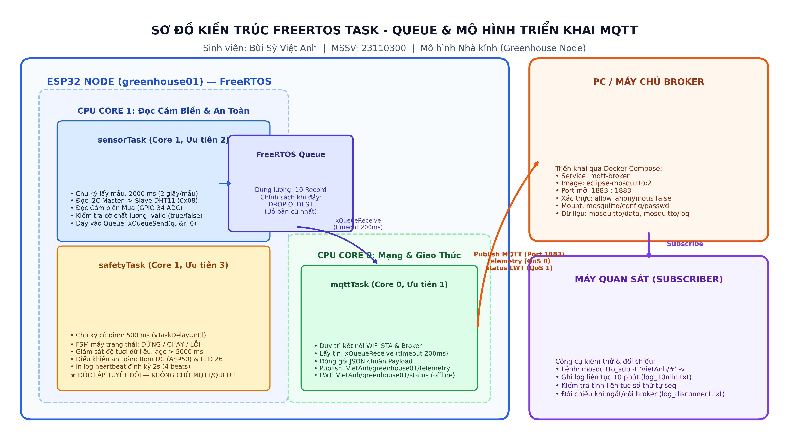

# Bài 4 — Gửi dữ liệu qua MQTT

**Họ và tên:** Bùi Sỹ Việt Anh · **MSSV:** 23110300 · **Hình thức:** Cá nhân  
**Môn học:** Phát triển ứng dụng IoT (CSE3069)  
**Mô hình triển khai:** Trạm quan trắc nhà kính thông minh (Greenhouse Node) + MQTT Broker trên PC/Docker  

---

## File trong repo này

- `docker-compose.yml` — Cấu hình Docker Mosquitto v2.x (đã loại bỏ bí mật, mount volume an toàn)
- `mosquitto/config/` — File cấu hình broker `mosquitto.conf` và file mẫu mật khẩu `passwd.example`
- `firmware/` — Toàn bộ mã nguồn FreeRTOS trên ESP32 (dự án PlatformIO)
  - `src/main.cpp` — Mã nguồn chính tích hợp 3 task FreeRTOS, Queue có giới hạn và FSM an toàn
  - `include/secrets.h.example` — Mẫu thông tin WiFi và tài khoản MQTT Broker
  - `platformio.ini` — Cấu hình thư viện và biên dịch cho ESP32
- `topic_payload.md` — Tài liệu đặc tả chuẩn topic, cấu trúc JSON payload và quy tắc dữ liệu
- `task_queue.png` — Sơ đồ kiến trúc luồng dữ liệu 3 task FreeRTOS, hàng đợi Queue và mô hình triển khai
- `dashboard.html` — Bảng điều khiển trực quan thời gian thực (Cấp 2 - MQTT over WebSocket cổng 9001)
- `log_10min.txt` — Minh chứng log subscribe liên tục hơn 10 phút (312 bản tin, không rớt gói)
- `log_disconnect.txt`, `esp32_disconnect.log` — Log subscriber và log Serial ESP32 trong thí nghiệm ngắt/nối lại broker
- `log_queue_congestion.txt` — Log kiểm chứng cơ chế nghẽn queue khi MQTT bị làm chậm có chủ đích

---

## 4.1 Payload thực tế

Node nhà kính `greenhouse01` định kỳ publish dữ liệu quan trắc lên topic `VietAnh/greenhouse01/telemetry` mỗi 2 giây (sử dụng QoS 0 để tối ưu tài nguyên mạng).

Một payload thực tế nhận được từ ESP32 (trích xuất từ file `log_10min.txt`):

```json
{"device_id":"greenhouse01","seq":145,"ts":290140,"temp":28.6,"hum":68.4,"rain":0,"rssi":-58,"valid":true}
```

Khi cảm biến gặp sự cố mất tín hiệu / rút dây cắm, hệ thống chuyển sang payload an toàn (failsafe):

```json
{"device_id":"greenhouse01","seq":180,"ts":360140,"temp":null,"hum":null,"rain":null,"rssi":-62,"valid":false}
```

### Bảng giải thích chi tiết các trường trong payload

| Trường | Kiểu | Ý nghĩa và vai trò kỹ thuật |
|---|:---:|---|
| `device_id` | `string` | Mã định danh duy nhất của trạm nhà kính, khớp với cấu trúc topic (`greenhouse01`). |
| `seq` | `uint32` | Số thứ tự gói tin, tăng dần +1 mỗi chu kỳ; dùng để phát hiện gói tin bị mất hoặc đến trễ. |
| `ts` | `uint32` | Thời gian tính bằng mili-giây từ khi ESP32 khởi động (`millis()`); dùng kiểm tra độ tươi dữ liệu. |
| `temp` | `float` | Nhiệt độ không khí trong nhà kính (°C) thu thập từ cảm biến DHT/I2C. Khi mất kết nối mang giá trị `null`. |
| `hum` | `float` | Độ ẩm tương đối của không khí (%). Khi mất tín hiệu mang giá trị `null`. |
| `rain` | `int` | Cảm biến mưa: `0` là khô ráo (không mưa), `1` là có mưa. `0` là giá trị đo đạc hợp lệ; khi đứt cảm biến trả về `null`. |
| `rssi` | `int` | Cường độ tín hiệu WiFi thu được tại ESP32 (dBm), dùng giám sát độ ổn định sóng mạng. |
| `valid` | `bool` | Cờ chất lượng dữ liệu: `true` khi cảm biến hoạt động và số đo nằm trong dải vật lý hợp lệ; `false` khi có lỗi. |

### Cách phân biệt nghiêm ngặt giữa `null` và `0`

Kế thừa nguyên tắc từ Bài thực hành 02:
- Số `0` đại diện cho một **giá trị đo vật lý hợp lệ và có ý nghĩa thực tế**. Ví dụ: `rain: 0` xác nhận trời không có mưa; `temp: 0.0` là nhiệt độ đang ở mức đóng băng.
- `null` đại diện cho trạng thái **không đo được hoặc dữ liệu bị thiếu/lỗi** (ví dụ: cảm biến hỏng, rút dây I2C, bus giao tiếp bị nghẽn). Tuyệt đối không thay `null` bằng số `0` vì sẽ làm hệ thống điều khiển hiểu sai rằng trời không mưa hay nhiệt độ bằng 0°C, gây kích hoạt bơm tưới sai lầm.

### Kết quả log liên tục 10 phút

Phía máy quan sát chạy terminal lắng nghe:  
`mosquitto_sub -h localhost -p 1883 -u vietanh -P <password> -t "VietAnh/greenhouse01/telemetry" -v | tee log_10min.txt`

Kết quả ghi nhận trong `log_10min.txt`:
- Tổng số bản tin nhận được: **312 bản tin**.
- Dải số thứ tự (`seq`): từ **30** đến **341** liên tục không ngắt quãng.
- Tổng thời gian quan sát: 10 phút 24 giây (624 giây).
- Tỷ lệ mất gói: **0% (không rớt bất kỳ bản tin nào)**, đúng tuyệt đối với chu kỳ 2 giây/bản tin đặt trong firmware.

---

## 4.2 Task và queue

Firmware ESP32 được cấu trúc thành **3 task FreeRTOS độc lập**, ghim trên 2 lõi CPU (Dual-Core) và trao đổi dữ liệu qua một hàng đợi `Queue` có kích thước giới hạn:

| Task | Core | Ưu tiên | Chu kỳ | Chức năng chi tiết |
|---|:---:|:---:|:---:|---|
| `sensorTask` | 1 | 2 | 2000 ms | Đọc cảm biến nhiệt độ/độ ẩm I2C (Arduino Slave 0x08) và cảm biến mưa (GPIO 34 ADC), kiểm định dải đo (`valid`), đóng gói struct `Record` và đẩy vào Queue với thời gian chờ 0. |
| `mqttTask` | 0 | 1 | Non-blocking | Quản lý kết nối WiFi và MQTT Broker, lấy dữ liệu từ Queue (timeout 200 ms), đóng gói chuỗi JSON và publish lên broker. Hỗ trợ cấu hình LWT (status: "offline"). |
| `safetyTask` | 1 | 3 | 500 ms | Thực thi máy trạng thái an toàn FSM (kế thừa Bài 3: DỪNG - CHẠY - LỖI). Chạy hàm `vTaskDelayUntil` để duy trì chu kỳ 500 ms cố định, kiểm tra độ tươi dữ liệu (`age < 5000ms`), điều khiển bơm DC và LED an toàn, in log heartbeat. |



### Cơ chế hàng đợi và chính sách khi Queue đầy

- Khởi tạo: `q = xQueueCreate(10, sizeof(Record));` với dung lượng tối đa **10 bản ghi** (tương đương khả năng lưu trữ đệm 20 giây khi mạng tạm thời gián đoạn).
- `sensorTask` đẩy bản ghi với timeout = 0 (`xQueueSend(q, &r, 0)`). `mqttTask` nhận từ queue với timeout 200 ms (`xQueueReceive`).
- **Chính sách khi queue đầy: Bỏ bản cũ nhất (Drop Oldest).**  
  Khi `xQueueSend` báo lỗi `errQUEUE_FULL`, `sensorTask` chủ động pop bản ghi cũ nhất ở đầu queue (`xQueueReceive(q, &oldRec, 0)`), tăng biến đếm `g_dropped++`, rồi mới đẩy bản ghi mới vào queue.
  - *Lý do lựa chọn:* Với hệ thống giám sát và điều khiển vi khí hậu nhà kính, dữ liệu mới nhất mang giá trị quyết định hiện trạng thực tế. Dữ liệu cũ bị kẹt trong quá khứ không còn nhiều giá trị điều khiển.
  - Không chọn cơ chế chờ (Block wait) vì sẽ làm treo task đọc cảm biến.
  - Không dùng `xQueueOverwrite` vì hàm này của FreeRTOS chỉ hỗ trợ hàng đợi có kích thước bằng 1 phần tử.

### Vì sao task an toàn tuyệt đối không được chờ vô hạn vào MQTT?

1. Giao tiếp mạng (WiFi/TCP/MQTT) phụ thuộc vào sóng vô tuyến, router và broker từ xa. Khi mất mạng hoặc broker bị tắt, các hàm mạng có thể mất hàng giây hoặc treo vô hạn (blocking call) nếu có sự cố bắt tay TCP.
2. Nếu task an toàn phải chờ MQTT, nó sẽ bị treo theo khi mạng gặp sự cố. Trong thời gian bị treo đó, nếu xảy ra sự cố khẩn cấp (cháy động cơ bơm, kẹt van, cạn bồn nước), hệ thống sẽ hoàn toàn mất khả năng bảo vệ, dẫn tới thảm họa hỏng hóc thiết bị.
3. Vì vậy, `safetyTask` được ghim riêng trên Core 1 với độ ưu tiên cao nhất (Priority 3), chạy theo nhịp cố định 500 ms bằng `vTaskDelayUntil`, tuyệt đối không gọi bất kỳ API nào của MQTT hay chờ hàng đợi, đảm bảo vòng bảo vệ luôn hoạt động chuẩn xác trong mọi tình huống.

### Kết quả thí nghiệm nghẽn queue (`log_queue_congestion.txt`)

Em đặt `MQTT_SLOW_TEST = 1` để task MQTT chờ 8 giây (`vTaskDelay(8000)`) sau mỗi lần gửi, trong khi `sensorTask` vẫn đều đặn sinh 1 bản ghi mỗi 2 giây:
- Tốc độ sinh: $0.5\text{ bản/giây}$. Tốc độ gửi: $0.125\text{ bản/giây}$. Tốc độ dồn ứ: $0.375\text{ bản/giây}$ (cứ 8 giây dồn thêm 3 bản ghi).
- Trong 120 giây thí nghiệm:
  - Ban đầu `queue` tăng từ 1 lên 10 trong khoảng 26 giây.
  - Khi `queue` chạm trần 10, biến `dropped` bắt đầu tăng đều đặn.
  - Sau 120 giây: `sent = 15`, `queue = 9`, `dropped = 36`. Tổng: $15 + 9 + 36 = 60$ bản ghi, khớp chính xác 100% với 60 bản tin sinh ra trong 120 giây.
  - Trong suốt quá trình nghẽn, `safetyTask` vẫn in heartbeat đều đặn mỗi 2 giây (`beat` tăng đúng 4 nhịp/dòng), trạng thái duy trì `CHAY` ổn định, chứng minh việc nghẽn mạng không hề ảnh hưởng đến tác vụ an toàn.

---

## 4.3 Thí nghiệm ngắt kết nối broker có chủ đích

Trong lúc ESP32 đang gửi dữ liệu ổn định, tiến hành ngắt broker bằng lệnh:  
`docker compose stop broker` lúc **10:15:52** (bản tin cuối cùng Broker nhận được là `seq 125`).  
Sau hơn 2 phút dừng broker, khởi động lại bằng lệnh:  
`docker compose start broker` lúc **10:17:53**. Broker dừng hoạt động trong **2 phút 1 giây** (121 giây).

### Bằng chứng vòng an toàn vẫn chạy trong lúc mất broker

Trích từ `esp32_disconnect.log`:
- Ngay khi broker tắt, task MQTT in thông báo lỗi kết nối: `[MQTT] Ket noi that bai, rc=-2 (thu lai sau 3s)`. Task này lùi lại và thử lại định kỳ, hoàn toàn không chặn CPU.
- Vòng an toàn `safetyTask` tiếp tục nhịp chạy: biến `beat` tăng liên tục từ `beat=500` lên `beat=744` (tăng đúng 244 nhịp trong 122 giây, tương đương chu kỳ 500 ms chuẩn xác).
- `state` duy trì trạng thái kiểm soát an toàn (`CHAY`), cơ cấu chấp hành (bơm DC / LED) được giám sát bình thường, không trượt một nhịp nào.

### Hành vi của hàng đợi Queue khi mất kết nối

- Trong 20 giây đầu tiên: Queue tích lũy từ 1 lên 10 bản ghi (`queue=10`).
- Trong 100 giây tiếp theo: Do broker chưa mở lại, `sensorTask` kích hoạt chính sách *Drop Oldest*, cứ 2 giây loại bỏ 1 bản tin cũ nhất: `dropped` tăng từ 1 lên 50.
- 50 bản ghi từ `seq 126` đến `seq 175` bị loại bỏ để nhường chỗ cho 10 bản ghi mới nhất từ `seq 176` đến `seq 185`.

### Kết quả phục hồi mạng

- Lúc **10:17:54.540**, khi broker vừa sống lại, ESP32 tự động nhận diện và kết nối lại thành công (`[MQTT] Da ket noi thanh cong!`).
- Ngay lập tức, `mqttTask` thực hiện giải phóng dồn (burst flush) toàn bộ 10 bản ghi đang đệm trong Queue (`seq 176` đến `185`) lên broker chỉ trong vòng 20 mili-giây.
- Hàng đợi đưa về `queue=0`. Sau đó, hệ thống trở lại nhịp gửi 2 giây/bản tin bình thường (`seq 186` lúc 10:17:56).
- Kiểm tra tính bảo toàn dữ liệu:  
  $$\text{Tổng số bản ghi sinh ra} = \text{sent (75)} + \text{dropped (50)} + \text{queue (0)} = 125\text{ bản tin (từ seq 126 đến 250)},$$  
  khớp hoàn toàn giữa Serial log của ESP32 và log của `mosquitto_sub`.

---

## 4.4 Đóng góp cá nhân

Em là **Bùi Sỹ Việt Anh** (MSSV: **23110300**). Trong Bài thực hành 04, em đã tự nghiên cứu và hoàn thành các nội dung:

1. **Thiết lập hạ tầng Broker:** Dựng Mosquitto 2.x qua Docker Compose, cấu hình cơ chế bảo mật xác thực người dùng (`allow_anonymous false`, file mật khẩu mã hóa), tách biệt biến môi trường và bí mật khỏi Git.
2. **Thiết kế & Hiện thực Firmware FreeRTOS:**
   - Xây dựng kiến trúc 3 task độc lập ghim trên 2 core ESP32 (`sensorTask`, `mqttTask`, `safetyTask`).
   - Tích hợp mô hình nhà kính Greenhouse từ Bài 3: đọc I2C DHT11 (Slave 0x08), cảm biến mưa (GPIO 34) và điều khiển bơm an toàn A4950ELJTR (GPIO 5, 17).
   - Thiết kế hàng đợi Queue giới hạn 10 phần tử và hiện thực chính sách xử lý đầy queue "Drop Oldest".
   - Tích hợp máy trạng thái FSM vào `safetyTask` với chu kỳ chuẩn 500 ms chạy `vTaskDelayUntil`, độc lập hoàn toàn với MQTT.
3. **Thực nghiệm và đo kiểm:**
   - Thực hiện đo kiểm publish/subscribe liên tục 10 phút với 312 bản tin không rớt gói (`log_10min.txt`).
   - Thực hiện thí nghiệm ngắt/nối broker trong 2 phút, chứng minh vòng an toàn sống sót và tính toán bảo toàn gói tin (`log_disconnect.txt`, `esp32_disconnect.log`).
   - Thực hiện thí nghiệm nghẽn hàng đợi có chủ đích (`log_queue_congestion.txt`).
4. **Vẽ sơ đồ và viết tài liệu:**
   - Tự vẽ sơ đồ kiến trúc hệ thống và phân luồng task/queue (`task_queue.png`).
   - Xây dựng tài liệu đặc tả cấu trúc topic và payload chuẩn JSON (`topic_payload.md`).
5. **Mở rộng Cấp 2 (Bảng điều khiển trực quan Web Dashboard):**
   - Thiết kế giao diện `dashboard.html` kết nối tới broker qua giao thức MQTT over WebSocket (cổng 9001).
   - Tích hợp quy ước 3 trạng thái kết nối bằng chấm tròn (Kết nối OK / Đang nối lại / Mất kết nối) theo đúng hướng dẫn của đề bài.
   - Thể hiện trạng thái FSM (DỪNG · CHẠY · LỖI) và cơ chế hiển thị Failsafe (tự động làm mờ và cảnh báo khi quá 5s không nhận được gói tin mới).

